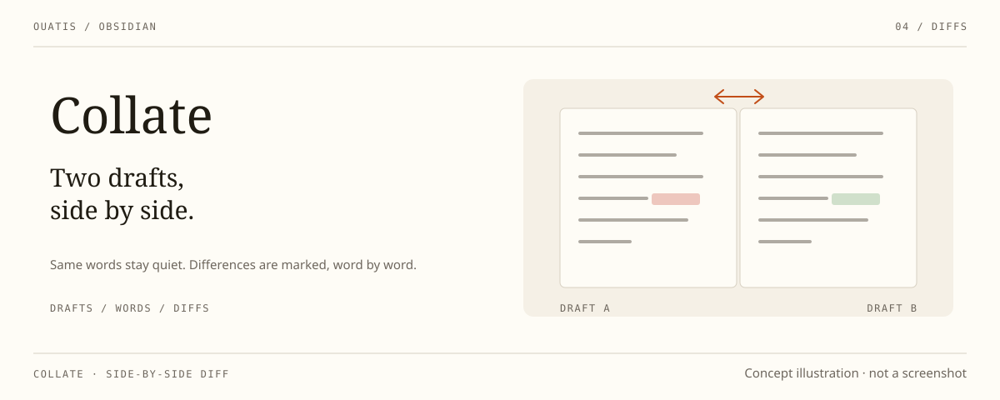

<div align="center">

# Collate

_Two drafts, side by side._

[简体中文](./README.zh-CN.md)

<p>
  
  
  
</p>

</div>



An Obsidian plugin that opens two notes in a native split and marks what
differs between them — in both notes, down to the word.

Chinese text is segmented through `Intl.Segmenter`, so differences are
highlighted word by word instead of line by line. Both sides read the
unsaved editor buffer first and refresh after a short debounce, identical
text is never colored, and the highlighting itself never writes to the
notes. Both sides of a split currently use the same word-difference color,
meaning "unique to this side" — not a unified add/delete direction.

Collate grew out of Till Friebe's
[obsidian-file-diff](https://github.com/friebetill/obsidian-file-diff) (MIT)
and is now maintained by SigiL as part of the ouatis Obsidian family,
alongside [Desk Lamp](https://github.com/ouatis/obsidian-desklamp),
[Skill Switchboard](https://github.com/ouatis/obsidian-skill-switchboard)
and [Scriptorium](https://github.com/ouatis/obsidian-scriptorium). Quiet
panels and thin rules share a visual rhythm with the rest of the family;
colors and fonts follow your Obsidian theme. English and Simplified Chinese
are available.

> [!NOTE]
> Collate is an early experimental build, verified on Windows desktop
> Obsidian only, and not yet submitted to the community plugin directory.

## Install

Requires Obsidian 0.15.0 or newer. Download `main.js`, `manifest.json` and
`styles.css` from the
[releases page](https://github.com/ouatis/obsidian-bigao/releases), place
them in `<vault>/.obsidian/plugins/bigao/`, then enable the plugin.

## Use

Run a command from the command palette:

| Command | What it does |
| --- | --- |
| `Collate: Start side-by-side comparison` | Pick a note and open it next to the current one in a left/right split |
| `Collate: Start top-and-bottom comparison` | The same, stacked vertically |
| `Collate: Close side-by-side comparison` | Close the comparison panes Collate created |
| `Collate: Compare two notes` | Full-document diff view |
| `Collate: Compare and merge` | Diff view with per-hunk merge actions |
| `Collate: Find sync conflicts and merge` | Walk through `sync-conflict` notes and merge them one by one |

In a Simplified Chinese Obsidian the same commands read `比稿：…`. The
side panel follows the source cursor while you write; the follow toggle
sits in its header. `Collate: Close side-by-side comparison` only closes
panes that still show the note Collate opened there; panes you have
repurposed are left alone. Merge actions modify notes — review the
differences and keep backups before confirming.

## Notes on scale

The full-diff view is bounded to 4,000 lines and 1,000,000 characters per
note, and the diff computation itself to 2,000 edits or 500 ms — oversized
inputs show an explicit message instead of a wrong "no differences". The
inline split highlighting caps at 4,000 lines per note; past the cap the
highlight stays empty, which must not be read as "no differences".

Editor highlighting requires the note to be in editing mode; reading mode
is not guaranteed to look the same. Comparison pairs are restored
automatically after a reload while both panes stay open.

## Development

With Node.js 22.6 or newer:

```sh
npm ci
npm run verify
```

runs the dependency audit, the installed-bundle regression, the strict
TypeScript check, the source unit tests, a clean production build and the
installed-vs-source parity checks. `AGENTS.md` records the maintenance
conventions; `README.local.md` and `src/RESTORE-PLAN.md` document the
restoration history.

`npm run package:candidate` writes a full candidate package with checksums
to `dist/candidate/` (three files; the inline diff runtime is bundled into
`main.js`). For a real desktop smoke test, provide the local Obsidian paths
and run `npm run test:obsidian` — it only ever touches isolated temporary
vaults.

## License

MIT, following upstream. Collate is based on
[obsidian-file-diff](https://github.com/friebetill/obsidian-file-diff) by
Till Friebe; the restoration baseline is the upstream `1.1.2` tag
(`d566ded402f72e1508f33b640d6f96d7c32c9a00`). The original copyright and
license text are preserved in [LICENSE](LICENSE).
