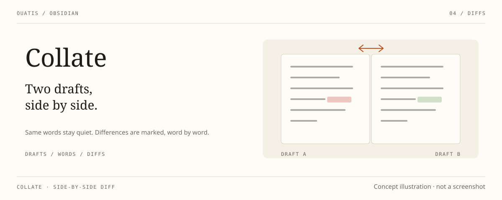

<div align="center">

# Collate · 比稿

_两份稿子，并排放着。_

[English](./README.md)

<a href="https://community.obsidian.md/plugins/bigao"></a>

<p>
  
  
  
</p>

</div>



在 Obsidian 原生左右或上下分屏中对照两篇 Markdown 笔记，并在两篇原文内按词高亮差异。

合并视图中的移动段落：移入块上是一行决定——接受移动、拒绝移动、拆开处理，移出块以徽章指回。

中文通过 `Intl.Segmenter` 分词，差异精确到词而不是整行。两侧都优先读取已打开笔记的未保存编辑缓冲区，编辑后短暂防抖刷新；相同内容不着色，高亮本身不改写笔记正文。分屏两侧目前使用相同的差异词配色，表示「这一侧独有的内容」，不代表统一的新增或删除方向。

比稿基于 Till Friebe 的 [obsidian-file-diff](https://github.com/friebetill/obsidian-file-diff)（MIT）修改，现由 SigiL 维护，与[小台灯](https://github.com/ouatis/obsidian-desklamp)、[技能接线台](https://github.com/ouatis/obsidian-skill-switchboard)、[Scriptorium](https://github.com/ouatis/obsidian-scriptorium) 同属 ouatis 的 Obsidian 家族：安静的面板与细线共享同一种节奏；配色与字体跟随你的 Obsidian 主题，提供中英文界面。

> [!NOTE]
> 比稿运行于桌面端 Obsidian（已在 Windows 实测）；不支持移动端。

## 安装

需要 Obsidian 1.8.7 或更新版本。从 [Releases 页面](https://github.com/ouatis/obsidian-bigao/releases)下载 `main.js`、`manifest.json`、`styles.css` 三个文件，放入 `<vault>/.obsidian/plugins/bigao/`，然后在第三方插件设置中启用。

## 命令

| 命令 | 作用 |
| --- | --- |
| `比稿：开启左右分屏对照` | 选择一篇笔记，在左右分屏中对照当前稿 |
| `比稿：开启上下分屏对照` | 同上，上下排列 |
| `比稿：关闭分屏对照` | 关闭由比稿创建且仍显示对照稿的窗格 |
| `比稿：对比两篇` | 全文差异视图 |
| `比稿：对比并合并` | 带逐段合并动作的全文差异视图 |
| `比稿：查找同步冲突并合并` | 逐篇处理 `sync-conflict` 笔记并合并 |

功能区的两栏图标可直接开启左右分屏对照，无需打开命令面板。英文界面的 Obsidian 中同样的命令显示为 `Collate: …`。侧边对照面板在写作时跟随原稿光标，面板头部有跟随开关。关闭命令不会关掉已被你改作他用的窗格。在两稿之间移动过的段落会被配成一对、合成一个决定——接受移动、拒绝移动，或拆开处理退回两段独立操作；近似移动（途中改过文字）会明确提示，并采用对照稿的文字。合并操作会修改笔记，确认前请检查差异并保留备份。

## 规模与限制

全文差异视图每篇最多 4,000 行、1,000,000 字符，差异计算上限为 2,000 次编辑或 500 毫秒——超限会显示明确提示，不会误报「无差异」。分屏行内高亮同样以每篇 4,000 行为上限，超限后高亮保持为空，不应据此判断两篇相同。

编辑器内高亮需要笔记处于编辑模式，不保证阅读模式显示同样效果；工作区重载后，只要两个对照窗格仍打开，对照关系与行内高亮会自动恢复。比稿为桌面端插件，不支持移动端。

## 开发与验证

```sh
npm ci && npm run verify
```

`npm run verify` 是完整的门禁：依赖审计、已安装包回归、严格 TypeScript 检查、源码单元测试、干净的生产构建，以及安装版与源码的行为对照。维护约定见 `AGENTS.md`。

## 来源与许可

MIT，沿用上游。比稿基于 [Till Friebe / obsidian-file-diff](https://github.com/friebetill/obsidian-file-diff)；还原所用基线为上游 `1.1.2` 标签（`d566ded402f72e1508f33b640d6f96d7c32c9a00`），原作者版权及许可文本保留在 [LICENSE](LICENSE)。
